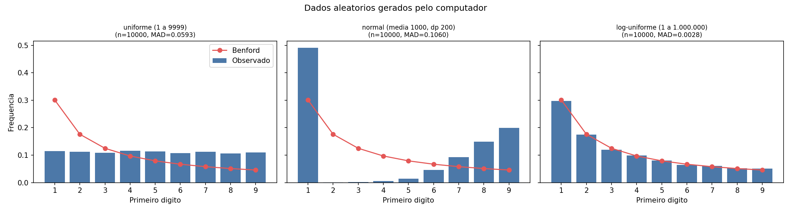
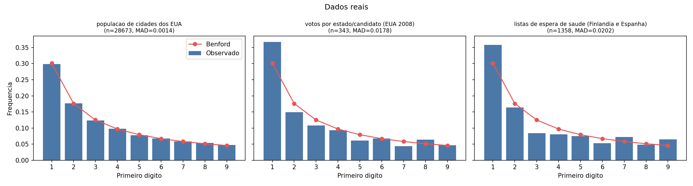

# 📊 Lei de Newcomb-Benford na prática

Análise da **Lei de Newcomb-Benford** aplicada a dados aleatórios gerados por computador e a conjuntos de dados reais, com gráficos e testes estatísticos.

> Trabalho de faculdade (FIAP): aplicar a lei em dados aleatórios, em pelo menos 3 listas de dados reais, apresentar as fontes, os gráficos e a análise.

---

## 🧠 O que é a lei?

Em muitos conjuntos de dados do mundo real, o **primeiro dígito** dos números **não** aparece com frequência igual. Os dígitos menores aparecem bem mais:

| Dígito              | 1     | 2     | 3     | 4    | 5    | 6    | 7    | 8    | 9    |
| ------------------- | ----- | ----- | ----- | ---- | ---- | ---- | ---- | ---- | ---- |
| Frequência esperada | 30,1% | 17,6% | 12,5% | 9,7% | 7,9% | 6,7% | 5,8% | 5,1% | 4,6% |

A fórmula é:

```
P(d) = log10(1 + 1/d)
```

Ela costuma valer para dados que cobrem **várias ordens de grandeza** (populações, valores financeiros, etc.) e é usada, por exemplo, em auditoria para detectar números suspeitos.

---

## 🔬 Como a análise funciona

Para cada conjunto de dados o script:

1. Extrai o primeiro dígito de cada número.
2. Calcula a frequência observada de cada dígito (1 a 9).
3. Compara com a frequência esperada por Benford.
4. Calcula duas medidas:
   - **Qui-quadrado (χ²)** com p-valor. Se p < 0,05, os dados diferem de Benford.
   - **MAD** (desvio absoluto médio). Quanto menor, mais próximo de Benford.

Referência de interpretação do MAD (Nigrini):

| MAD            | Conformidade |
| -------------- | ------------ |
| até 0,006      | Próxima      |
| 0,006 a 0,012  | Aceitável    |
| 0,012 a 0,015  | Marginal     |
| acima de 0,015 | Não conforme |

---

## 📁 Estrutura do projeto

```
.
├── benford.py               # script principal (análise + gráficos)
├── resultados.csv           # tabela final com as métricas
├── grafico_aleatorios.png   # gráficos dos dados aleatórios
├── grafico_reais.png        # gráficos dos dados reais
└── README.md
```

---

## 🎲 Dados aleatórios (n = 10.000 cada)

| Conjunto                     | MAD    | p-valor | Segue Benford? |
| ---------------------------- | ------ | ------- | -------------- |
| Uniforme (1 a 9999)          | 0,059  | ≈ 0     | ❌             |
| Normal (média 1000, dp 200)  | 0,106  | ≈ 0     | ❌             |
| Log-uniforme (1 a 1.000.000) | 0,0028 | 0,18    | ✅             |



## 🌍 Dados reais

| Conjunto                                        | n      | MAD    | p-valor | Resultado               |
| ----------------------------------------------- | ------ | ------ | ------- | ----------------------- |
| População de cidades dos EUA                    | 28.673 | 0,0014 | 0,55    | ✅ Conformidade próxima |
| Votos por estado e candidato (EUA 2008)         | 343    | 0,0179 | 0,20    | ⚠️ Ambíguo              |
| Listas de espera de saúde (Finlândia e Espanha) | 1.358  | 0,0202 | ≈ 0     | ❌ Não segue            |



---

## 📚 Fontes dos dados

Os conjuntos reais vêm do repositório
[byuidatascience/data4benfords](https://github.com/byuidatascience/data4benfords) (pasta `data-raw`), que reúne dados públicos usados em estudos sobre Benford:

| Dado                                           | Arquivo         | Origem                                                                                            |
| ---------------------------------------------- | --------------- | ------------------------------------------------------------------------------------------------- |
| População de cidades dos EUA                   | `cities_us.csv` | [SimpleMaps – US Cities](https://simplemaps.com/data/us-cities)                                   |
| Eleição presidencial EUA 2008 (Obama × McCain) | `election.csv`  | [midnightradio/cse140-data-programming](https://github.com/midnightradio/cse140-data-programming) |
| Listas de espera de saúde                      | `waitlist.csv`  | Repositório data4benfords (confira a origem original lá)                                          |

---

## ▶️ Como rodar

**1. Instale as dependências**

```bash
pip install numpy pandas matplotlib scipy
```

**2. Baixe os dados reais**

```bash
B=https://raw.githubusercontent.com/byuidatascience/data4benfords/master/data-raw
curl -L -o cities_us.csv $B/cities_us/cities_us.csv
curl -L -o election.csv  $B/election/election.csv
curl -L -o waitlist.csv  $B/waitlist/waitlist.csv
```

**3. Execute o script**

```bash
python benford.py
```

Ele imprime a tabela de resultados no terminal e gera `grafico_aleatorios.png`, `grafico_reais.png` e `resultados.csv`.

> Os números aleatórios usam semente fixa (`seed = 42`), então os resultados são reproduzíveis.

---

## 💡 Conclusões

- **Aleatório não é o mesmo que Benford.** Números sorteados de forma uniforme ou normal não seguem a lei. Só o log-uniforme seguiu, porque espalha os valores por várias ordens de grandeza.
- **Populações de cidades seguem muito bem**, pois cobrem desde dezenas até milhões de habitantes.
- **Eleição dos EUA é inconclusiva**: a amostra é pequena (343 valores) e o MAD infla com poucos dados. O teste qui-quadrado não rejeita Benford.
- **Listas de espera não seguem**, pois são contagens limitadas pelo tamanho de cada serviço, sem grande variação de escala.

**Resumo:** a lei funciona quando os dados cobrem várias ordens de grandeza e não têm limites artificiais. Fugir de Benford não prova fraude, só indica que os dados não têm as características que a lei pede.

---

## 🛠️ Tecnologias

Python · NumPy · pandas · Matplotlib · SciPy

## 👤 Autor

**Jorge** — Engenharia de Software, FIAP
GitHub: [@jorgemeert](https://github.com/jorgemeert)
